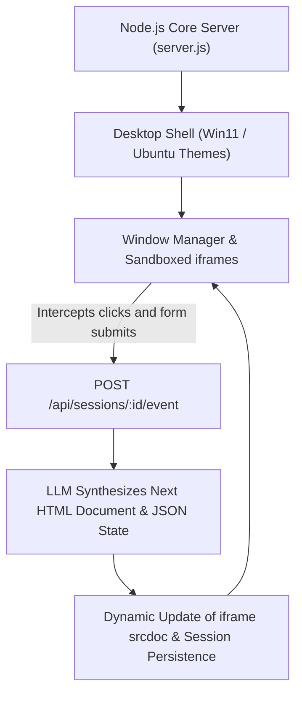

[简体中文](README.md) | English

# VibeOS Demo

**An experimental web desktop operating system driven by LLM-generated runtime UIs.**

`VibeOS Demo` is a local Node.js service and browser desktop environment demonstrating dynamic software synthesis. Rather than rendering pre-built static UI components, each application window operates as an isolated sandbox `iframe` bound to its own session. User interactions (clicks, text input, form submissions) are captured across an event bridge and fed to an LLM, which streams back the subsequent HTML document and structured application state on the fly.

---

## Architecture & Interaction Loop



* **Isolated Sandbox Execution**: Every application window runs in a decoupled iframe with its own session state, preventing cross-window script interference.
* **Transparent Event Bus**: Automatically captures DOM events inside iframes without requiring applications to bundle client-side SDKs.
* **Dual Operation Modes**: Includes a zero-config `mock` provider for instantaneous offline exploration, alongside seamless OpenAI and Anthropic API bindings.
* **Rich Default App Suite**: Features an integrated file viewer, terminal shell, web browser, calculator, task organizer, text editor, and the natural-language "Vibe Prompt" application builder.

---

## Quick Start

### Requirements
* **OS**: Windows 10 / 11, macOS, or Linux
* **Runtime**: Node.js 20 or newer
* **Browser**: Chrome, Edge, or Chromium-based browsers

### Launching the System

```powershell
# 1. Duplicate environment template (defaults to offline mock mode)
Copy-Item .env.example .env

# 2. Launch server (PowerShell)
.\start.ps1

# Or run directly via Node
node src/server.js
```

Once listening, open `http://127.0.0.1:8765` in your browser.

*To stop the background process, press `Ctrl+C` in the terminal or execute `.\stop.ps1`.*

---

## Model Configuration

Configure your chosen foundation model inside `.env`:

### 1. OpenAI / Compatible Endpoints
```env
LLM_PROVIDER=openai
OPENAI_API_KEY=your-api-key
OPENAI_BASE_URL=https://api.openai.com/v1
OPENAI_MODEL=gpt-4.1-mini
LLM_THINKING_LEVEL=off     # Supports off, low, medium, high, max
```

### 2. Anthropic Claude Endpoints
```env
LLM_PROVIDER=anthropic
ANTHROPIC_API_KEY=your-api-key
ANTHROPIC_BASE_URL=https://api.anthropic.com
ANTHROPIC_MODEL=claude-3-5-sonnet-latest
LLM_THINKING_LEVEL=off
```

---

## Repository Structure

* **`.env.example`**: Runtime environment parameters and provider template
* **`start.ps1` / `stop.ps1`**: Windows process automation scripts
* **`src/`**: Server-side engine
  * `server.js`**: HTTP API, session lifecycle management, and provider routing
  * `model-output.js`**: Structured JSON state extraction and validation
  * `vibe-runtime.js`**: Runtime UI injection script
  * `logger.js`**: NDJSON structured log rotator
* **`public/`**: Frontend desktop and window manager
  * `index.html`**: Desktop shell layout
  * `styles.css`**: Window manager styling and theme rules
  * `app.js`**: Window supervisor and iframe event bridge

---

## License

This project is open-sourced under the [MIT License](LICENSE).
