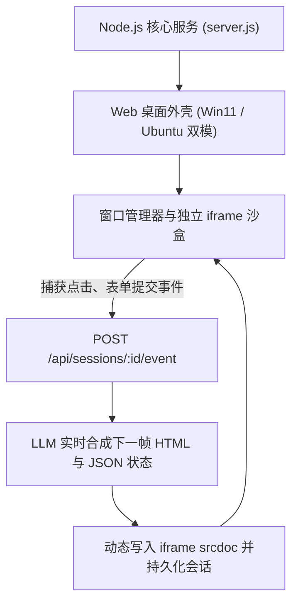

简体中文 | [English](README.en.md)

# VibeOS Demo

**基于 Node.js 与 Web 沙盒的 LLM 运行时生成式桌面操作系统实验**。

`VibeOS Demo` 是一个探索“大语言模型实时驱动软件界面”的原生 Web 桌面系统。不同于静态硬编码的传统 Web 应用，系统内的每一个应用窗口均为运行在沙盒 `iframe` 中的独立会话。用户在应用内的每一次交互（点击、表单提交、输入变更）均由事件桥梁捕获并提交至后端，大模型实时根据会话状态合成下一个 HTML 界面与结构化应用状态，实现交互式界面的即时演进。

---

## 核心设计与工作流程



* **独立沙盒会话隔离**：每个应用窗口拥有专有会话 ID 与状态字典，窗口间运行环境严格物理隔离。
* **原生事件总线桥接**：透明监听 iframe 内部的 DOM 事件流，无需应用内部预置复杂框架。
* **双模支持**：内置 `mock` 模式，零网络请求与 API Key 即可启动完整交互体验；支持无缝切换至 OpenAI 或 Anthropic 原生大模型。
* **预置丰富应用套件**：内置文件管理器、终端模拟器、浏览器、计算器、任务便签、文本编辑器，以及支持自然语言随心生成新应用的“Vibe Prompt”生成器。

---

## 快速开始

### 环境依赖
* **操作系统**：Windows 10 / 11、macOS 或 Linux
* **运行环境**：Node.js 20 或更高版本
* **推荐浏览器**：Chrome、Edge 或 Chromium 系列

### 启动服务

```powershell
# 1. 复制配置文件（默认开启 mock 离线模式，免 Key 体验）
Copy-Item .env.example .env

# 2. 启动服务（Windows PowerShell）
.\start.ps1

# 或使用标准 Node 命令启动
node src/server.js
```

启动成功后，在浏览器中访问：`http://127.0.0.1:8765`。

*如需停止服务，可在终端按 `Ctrl+C`，或运行 `.\stop.ps1`。*

---

## 模型提供商配置

在 `.env` 文件中可配置真实的大模型生成驱动：

### 1. OpenAI / OpenAI 兼容端点
```env
LLM_PROVIDER=openai
OPENAI_API_KEY=your-api-key
OPENAI_BASE_URL=https://api.openai.com/v1
OPENAI_MODEL=gpt-4.1-mini
LLM_THINKING_LEVEL=off     # 支持 off, low, medium, high, max
```

### 2. Anthropic Claude 端点
```env
LLM_PROVIDER=anthropic
ANTHROPIC_API_KEY=your-api-key
ANTHROPIC_BASE_URL=https://api.anthropic.com
ANTHROPIC_MODEL=claude-3-5-sonnet-latest
LLM_THINKING_LEVEL=off
```

---

## 目录结构

* **`.env.example`**：运行参数与模型配置模板
* **`start.ps1` / `stop.ps1`**：Windows 快捷启停脚本
* **`src/`**：核心服务端实现
  * `server.js`：HTTP 服务、会话生命周期与模型分发调度
  * `model-output.js`：JSON 状态结构化提取与响应校验
  * `vibe-runtime.js`：运行时动态界面注入辅助脚本
  * `logger.js`：NDJSON 结构化轮转日志记录器
* **`public/`**：前端桌面与窗口管理器
  * `index.html`：桌面外壳骨架
  * `styles.css`：窗口管理器与桌面主题样式
  * `app.js`：窗口调度系统与 iframe 通信事件桥

---

## 许可证

本项目基于 [MIT License](LICENSE) 开源。
